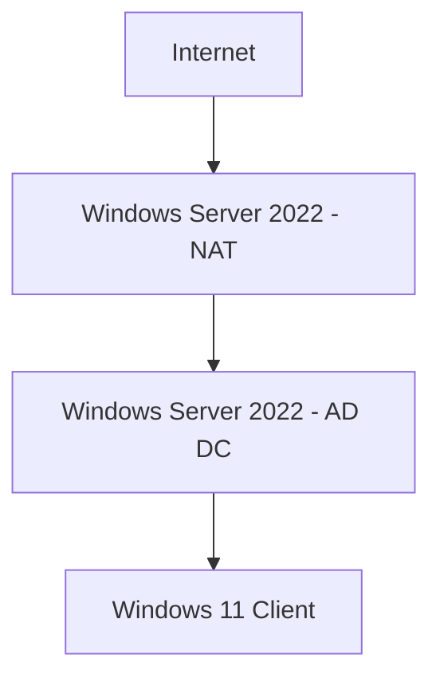

# 💻 Active-Directory-and-Powershell-Automation-Lab 💻
# Overview 
## Discover a production-ready lab configuration  that demonstrates deploying and configuring core enterprise IT infrastructure. This documentation walks through building a Windows Server 2022 AD DC, setting up DHCP and NAT-based Remote Access, bulk-managing users with PowerShell scripts, and successfully joining a Windows 11 client to the domain, with a strong emphasis on security and operational efficiency.
# Network Topology 

# Objective 
<ul>
    <li> Set up Active Directory Domain (2022) </li>
    <li> Configure DHCP Server </li>
    <li> Set up Remote Access and NAT for internal network routing </li>
    <li> Add 120  users and 4 Organizational Units (OUs) via PowerShell</li>
    <li> Join a Windows 11 machine to the domain </li>
    <li> Authenticate users and verify network connectivity </li>
    <li> Deploy security policies for domain users</li>
</ul>

# Hardware Requirement 
<ul>
    <li>Windows 11 client, 16 GB RAM, AMD processor, 255-1 TB storage space. </li>
    <li>VM application running on os  (Hyper-V, VMware, Parallels Desktop).</li>
    <li>Note pad to document the issue and solution. </li>
    <li>ISO windows server 22 (get it from the actual Microsoft website and not a 3rd party) </li>
    <li>ISO Windows 11 (get it from the actual Microsoft website and not a 3rd party) </li>
</ul>

# 1. Setting up Active Directory 
<ul>
    <li>Launch Windows Server 2022 VM</li>
    <li>Rename Network Interfaces for clarity</li>
    <li>Assign Static IP to the Internal NIC (10.0.0.0)</li>
    <li>Rename the Server to DC</li>
    <li>Install Active Directory Services</li>
    <li>Promote the Server to a Domain Controller with the domain locallab.com</li>
    <li>Verify Domain Controller Status</li>
</ul>
