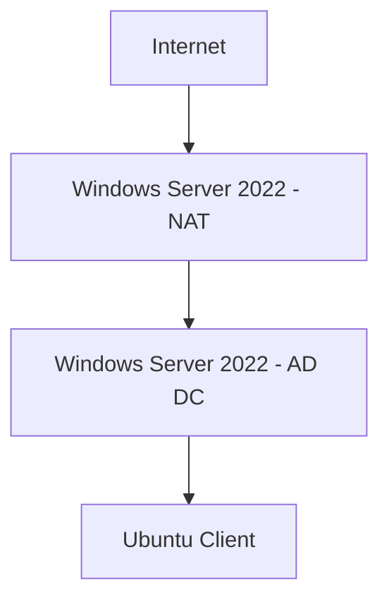

# 💻 Active-Directory-and-Powershell-Automation-Lab 💻
# Overview 
## Discover a production-ready lab configuration  that demonstrates how to deploy and configure core enterprise IT infrastructure. This documentation walks through building a Windows Server 2022 AD DC, setting up DHCP and NAT-based Remote Access, bulk-managing users with PowerShell scripts, and successfully joining an Ubuntu client by using Bash to the domain, with a strong emphasis on security and operational efficiency.
# Network Topology 

# Objective 
<ul>
    <li> Set up Active Directory Domain (2022) </li>
    <li> Configure DHCP Server </li>
    <li> Set up Remote Access and NAT for internal network routing </li>
    <li> Add 120  users and 4 Organizational Units (OUs) via PowerShell</li>
    <li> Join a Windows 11 machine to the domain </li>
    <li> Authenticate users and verify network connectivity </li>
    <li> Deploy security policies for domain users</li>
</ul>

# Hardware Requirement 
<ul>
    <li>Windows 11 Home, 16 GB RAM, AMD processor, 255-1 TB storage space. </li>
    <li>VM application running on os  (Hyper-V, VMware, Parallels Desktop).</li>
    <li>Note pad to document the issue and solution. </li>
    <li>ISO Windows Server 22 (get it from the actual Microsoft website and not a 3rd party) </li>
    <li>Ubuntu (get it from the actual Ubuntu website and not a 3rd party) </li>
    <li>Oracle Virtualbox Vertulizer </li>
</ul>

# 1. Setting up Active Directory 
<ul>
    <li>Launch Windows Server 2022 VM</li>
    <li>Rename Network Interfaces for clarity</li>
    <li>Assign Static IP to the Internal NIC (192.168.1.10)</li>
    <li>Rename the Server to AC-DC</li>
    <li>Install Active Directory Services</li>
    <li>Promote the Server to a Domain Controller with the domain locallab.com</li>
    <li>Verify Domain Controller Status</li>
</ul>

# 2.Installing and Configuring DHCP 
<ul>
    <li>Install DHCP Server Role</li>
    <li>Create a DHCP Scope (10.0.0.100 - 10.0.0.200)</li>
    <li>Set Router/Gateway IP (10.0.0.2) </li>
    <li> Authorize the DHCP Server in AD-DC </li>
    <li> Verify successful lease assignments </li>
</ul>

# 3. Setting Up Remote Access and NAT
<ul>
    <li> Install Remote Access Role </li>
    <li> Enable Routing and Remote Access  </li>
    <li> Configure NAT for Internal Network Routing </li>
    <li> Set up Internet Connectivity through the NAT interface </li>
    <li> Verify network routing between client machines </li>
</ul>

# 4. Adding 120 Users and Organizational Units (OUs) via PowerShell
<ul>
    <li>Write a PowerShell command  that adds OUs, departments, and sub-OUs.</li>
    <li>Write a PowerShell command for  a John Doe user for finance with name, email, password, and username. </li>
    <li>Write a PowerShell command that verifies your changes.</li>
</ul>

# 5.Joining Ubuntu Client to the Domain via Bash
<ul>
    <li>Install Ubuntu VM</li>
    <li>Ensure Network Connectivity (Internal and Internet)</li>
    <li>Join Ubuntu Machine to Locallab.com</li>
    <li>Authenticate with Domain Admin </li>
    <li>Verify DHCP IP Assignment</li>
    <li>Ensure domain policies are applied correctly</li>
</ul>

# 6. Authenticating a Random User on Windows 11
<ul>
    <li>Pick a Random User</li>
    <li>Login to Ubuntu using John Doe's credentials</li>
    <li>Verify Network Configuration (ipconfig command)</li>
    <li>Ensure the user has the correct permissions based on their OU</li>
</ul>

# 7. Implementing Security Policies for Users
<ul>
    <li>Create Group Policies for different OUs</li>
    <li>Restrict administrative access to non-admin users</li>
    <li>Enable password policies and login restrictions</li>
    <li>Deploy user-specific access control based on job roles</li>
</ul>

# 8. Results 
<ul>
    <li>90% Time Reduction ✅</li>
    <li>99.9% Uptime ✅</li>
    <li>Stronger Security ✅</li>
    <li>Real-World Simulation ✅</li>
</ul>
